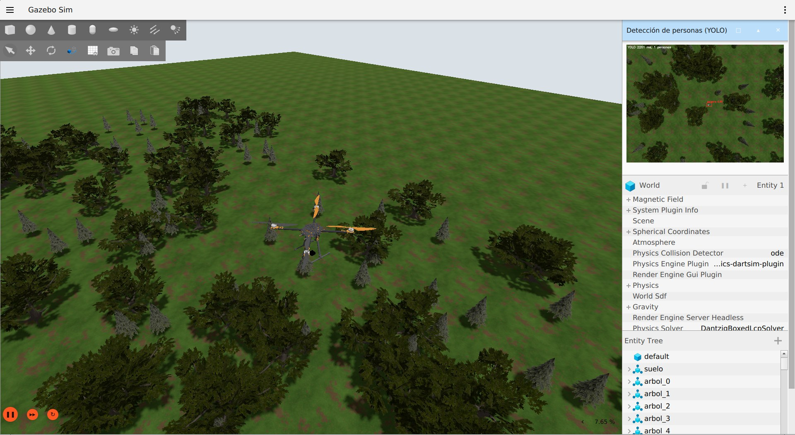
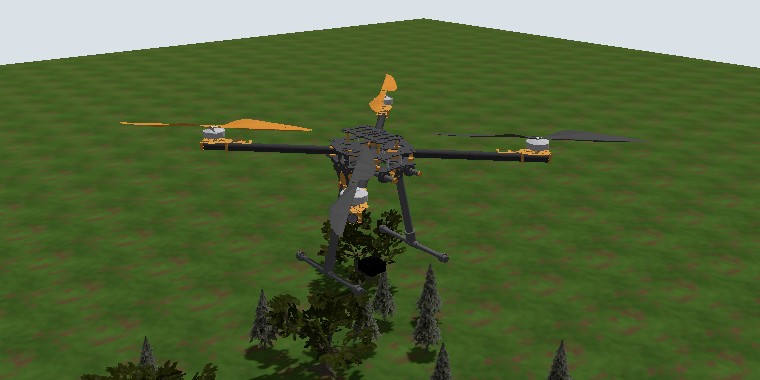
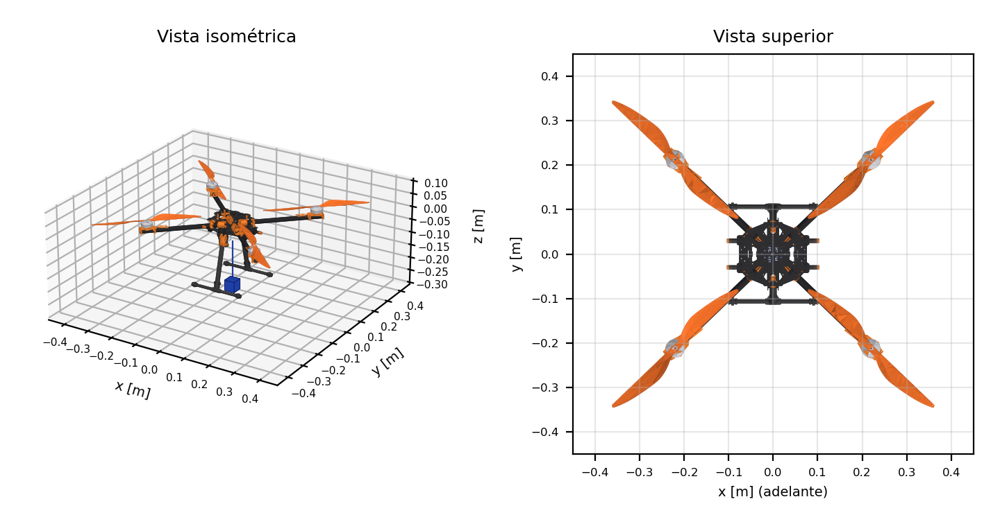
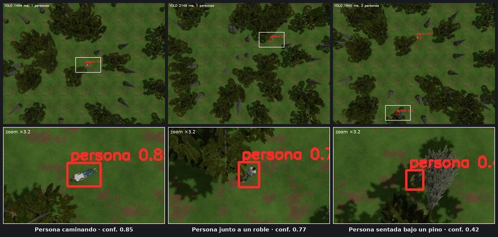
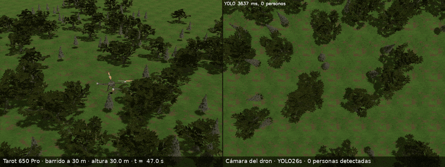
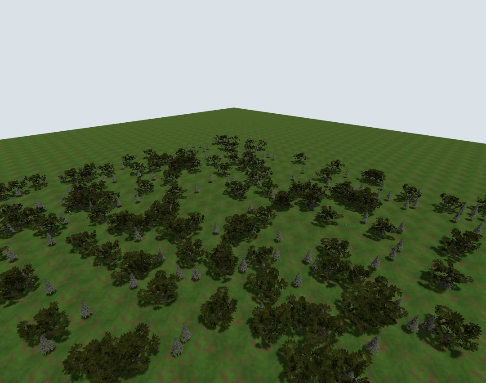
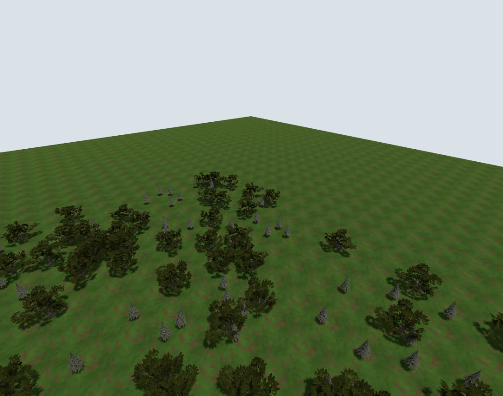
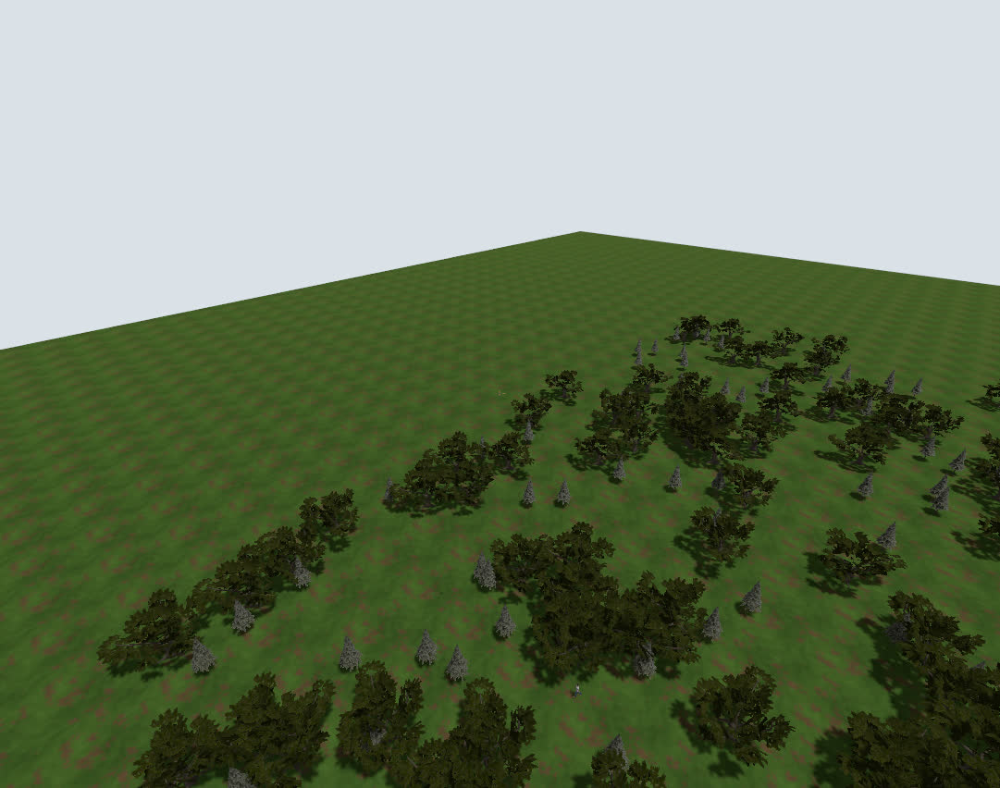

# Búsqueda de personas en bosque con un vehículo aéreo no tripulado

Percepción y estimación visual embarcada para que un **Tarot 650 Pro** busque y localice personas en
un bosque por sí solo. Dr. Jairo Olguín Roque, FES Acatlán, UNAM.



## El dron: Tarot 650 Pro

| El Tarot 650 Pro en Gazebo | Mallas del CAD (la caja azul es la cámara) |
|---|---|
|  |  |

El vehículo de todas las simulaciones es el Tarot 650 Pro (`vehiculo:=tarot650`, el valor por
omisión), con las mallas de su CAD y los sensores que necesitan PX4 y ArduPilot.

| Parámetro | Valor |
|---|---|
| Configuración | Cuadricóptero en X, rotores en (±0.220, ±0.212) m, hélices de 15″ |
| Masa total | 2.25 kg (cuerpo 2.12 kg, rotores 4 × 20 g, cámara 50 g) |
| Motores | ω<sub>máx</sub> 680 rad/s, k<sub>f</sub> 4.24 × 10⁻⁵ N/(rad/s)², 19.6 N de empuje máximo cada uno (≈ 3.6 veces el peso) |
| Cámara | 1280 × 960 px, campo horizontal de 1.74 rad (100°), mirando hacia abajo, 24 cm bajo el centro |
| LiDAR 3D | 360° × 16 canales (−35° a +15°), 30 m, 10 Hz, para la evasión de obstáculos |
| Piloto | PX4 1.17 (airframe `4100_gz_tarot650_busqueda`) o ArduCopter 4.7 con EKF3 (`config/ardupilot/tarot650.parm`) |
| Modelos de Gazebo | `models/tarot650_busqueda` (PX4) y `models/tarot650_busqueda_ardupilot` |

La masa, las inercias, k<sub>f</sub> y los retardos de los motores son supuestos: para volar un Tarot
real hay que reemplazarlos por los medidos y regenerar el modelo (`scripts/generar_vehiculo.py`).

## Cámara y detección de personas con YOLO26



Lo que ve la cámara del Tarot desde 30 m sobre la ruta de barrido, con las cajas que dibuja
`detector_node` usando `yolo/personas_yolo26s.pt` (YOLO26s ajustado con 3000 imágenes del simulador).
Abajo, el acercamiento a cada detección: a esa altura una persona ocupa unos 20 px de la imagen. La
persona sentada bajo un pino sale con 0.42 porque la copa la tapa a medias; por eso la misión junta
varias detecciones de la misma persona antes de avisar.

```
/camera (Gazebo, 1280×960) → detector_node (YOLO26s) → /detecciones → localizador_node (rayo–terreno)
                                    └→ /camera_yolo (panel de Gazebo)      └→ /personas/candidatas → aviso con GPS
```

| Detector (validación, 300 imágenes) | AP50 | AP50-95 | Precisión | Recall | Tiempo por imagen |
|---|---|---|---|---|---|
| YOLO26s ajustado (`personas_yolo26s.pt`) | 0.954 | 0.692 | 0.96 | 0.92 | 15.6 ms (RTX 5060 Ti) |

Capturas del 5 nov 2026 en el bosque de la tabla de resultados (oclusión media, sol alto, semilla 1:
295 árboles, 45 % de cobertura, 3 personas), con el Tarot colocado en puntos de la ruta a 30 m. La
inferencia corrió en CPU (≈ 2 s por cuadro, el tiempo que aparece arriba a la izquierda de cada imagen);
en la RTX 5060 Ti tarda 15.6 ms.

<!-- demo -->
## Demostración



Misión de barrido fijo con `piloto:=ardupilot` y el controlador en cascada: despegue, 8 puntos de ruta a 30 m sobre un bosque de 295 árboles (cobertura 45 %) y aterrizaje; la misión terminó en 356 s con un RMSE de seguimiento de 0.10 m. Video: [docs/demo/demo.mp4](https://github.com/jairoroke/Busqueda-de-personas-en-bosque-con-un-vehiculo-aereo-no-tripulado/raw/main/docs/demo/demo.mp4)

| Inicio del barrido | Mitad | Final |
|---|---|---|
|  |  |  |

Corrida en Ubuntu 24.04 (WSL2), ROS 2 Jazzy, Gazebo Harmonic y ArduCopter 4.7 SITL.

<!-- /demo -->

Simulación integrada en ROS 2 Jazzy + Gazebo Harmonic: bosque generado por factores, Tarot 650 Pro
con cámara y LiDAR (o el x500 de PX4 con `vehiculo:=x500`), detector YOLO26s, localización rayo–terreno con fusión, avisos con coordenadas GPS,
misión de barrido fijo o con re-observación, controlador en cascada o red neuronal, con PX4 1.17 o
ArduCopter 4.7, y estación de tierra MAVProxy.

| Qué | Dónde |
|---|---|
| Libro para principiantes (todo el proyecto paso a paso) | [`src/mision/doc/manual/main.pdf`](../src/mision/doc/manual/main.pdf) |
| Referencia técnica, argumentos y resultados | [`src/mision/README.md`](../src/mision/README.md) |
| Paquete principal (nodos, launch, scripts, modelos) | `src/mision` |
| Plugin de Gazebo para elegir motores (ArduPilot + red) | `src/mision_gz_plugins` |

## Clonar y compilar

El repositorio tiene la forma de un espacio de trabajo de ROS 2:

```bash
git clone https://github.com/jairoroke/Busqueda-de-personas-en-bosque-con-un-vehiculo-aereo-no-tripulado.git ~/ros2_ws
cd ~/ros2_ws/src
git clone -b release/1.17 https://github.com/PX4/px4_msgs.git
git clone https://github.com/ArduPilot/ardupilot_gazebo.git      # solo para piloto:=ardupilot
cd ~/ros2_ws && colcon build --symlink-install && source install/setup.bash
```

PX4 (`release/1.17`, objetivo `px4_sitl_neural`), el agente Micro XRCE-DDS 2.4.3 y los
entornos de Python se instalan con `src/mision/scripts/instalar_entorno.sh` (sección
«Instalación» del README del paquete). ArduCopter 4.7.2 SITL va en `~/ardupilot`. El dataset del
detector (`~/datasets/personas_bosque`, 3000 imágenes) no está en el repositorio: se regenera con
`src/mision/scripts/capturar_dataset.py`.

## Lanzar

```bash
ros2 launch mision simulacion.launch.py                                    # PX4, cascada, barrido fijo
ros2 launch mision simulacion.launch.py estrategia:=reobs controlador:=red
ros2 launch mision simulacion.launch.py piloto:=ardupilot controlador:=red
```
